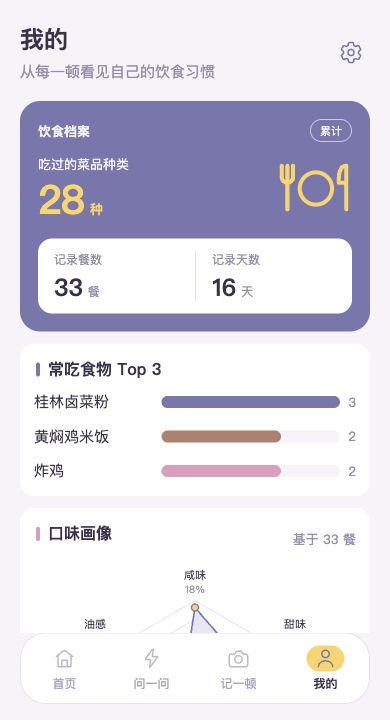

# 今天吃什么 · v4 测试与演示交付

当前分支 **v4**，对应固定版本 **4.0.0**。星级健康指数、四维推荐依据、九档预算统一和已有记录真实配图。

| 分支 | 固定版本 | 重点 |
|---|---|---|
| [v1](https://github.com/Y-PanC/jin-tian-chi-shen-me/tree/v1) | 1.0.0 | 偏好引导、当顿问答、规则推荐和本机饮食记录原型 |
| [v2](https://github.com/Y-PanC/jin-tian-chi-shen-me/tree/v2) | 2.0.0 | 登录注册、Python 后端、账号隔离、饮食记录和自动照片识别 |
| [v3](https://github.com/Y-PanC/jin-tian-chi-shen-me/tree/v3) | 3.0.0 | 三步多选问答、分页推荐、真实菜式图、健康分和独立推荐依据页 |
| [v4](https://github.com/Y-PanC/jin-tian-chi-shen-me/tree/v4) | 4.0.0 | 星级健康指数、四维推荐依据、九档预算统一和已有记录真实配图 |

每个版本建议单独克隆到不同目录，使用独立账号和数据。`v4` 为包含最新合并修改的 v4.0 正式版。

## 直接启动 Yunzhong 演示

已随分支附带演示专用账号和 33 条饮食记录：

| 项目 | 内容 |
|---|---|
| 账号 | `Yunzhong`（登录不区分大小写） |
| 密码 | `1234567890` |
| 记录 | 33 餐、16 天、28 种菜品；保留菜名、标签、用餐时间、备注和偏好 |
| 配图 | 使用 v4 已附带的真实菜式参考图 |

这组凭据公开供测试、演示使用。新部署在首次启动时创建演示账号，重启后保留新增、编辑和删除，不重复导入；其他新注册账号仍从空记录开始。

需要 Python 3.11+。从仓库根目录运行：

```sh
git clone --branch v4 --single-branch https://github.com/Y-PanC/jin-tian-chi-shen-me.git today-food-v4
cd today-food-v4
python3 -m venv .venv
.venv/bin/python -m pip install -r release/mobile-web/backend/requirements.lock
.venv/bin/python -m demo.serve
```

打开 <http://127.0.0.1:5177/page_login.html>，使用上面的账号登录。Windows 将 `.venv/bin/python` 换成 `.venv\Scripts\python.exe`。

服务默认只绑定本机。演示数据库和后续上传照片保存在仓库根目录 `.demo-data/`，不会进入 Git。记录日期保留原始日期，可在“最近饮食”中查看历史日期。

## Docker 部署

```sh
cp .env.demo.example .env.demo
docker compose --env-file .env.demo -f compose.demo.yaml up --build -d
```

同样打开 <http://127.0.0.1:5177/page_login.html>。数据库和照片保存在 `demo-data` 持久卷中，重启和重建容器保留数据。

本次已实测 Python 启动、登录、记录、统计和重启保留数据；Docker Compose 配置检查通过，本机未运行 Docker daemon，容器镜像构建和运行尚未实测。

对外演示时，在 `.env.demo` 中将 `ALLOWED_HOSTS` 设置为实际域名或 IP；需要直接暴露端口时设置 `DEMO_BIND=0.0.0.0`。HTTPS 反向代理部署设置 `COOKIE_SECURE=true`，并正确传递 Host 和协议；本机 HTTP 保持 false。云平台直接运行 Python 时可使用：

```sh
.venv/bin/python -m demo.serve --host 0.0.0.0 --port 8000
```

完整应用需要 Python 后端。GitHub Pages 仅提供静态文件，不能运行账号登录和数据保存。

## 文件位置

| 路径 | 内容 |
|---|---|
| `demo/` | 演示账号快照、一次性初始化、演示启动入口及相关测试 |
| `Dockerfile.demo`、`compose.demo.yaml` | 带持久存储的演示部署 |
| `release/mobile-web/dist/` | 本版前端页面、脚本、本地数据与图片资产 |
| `release/mobile-web/backend/` | Python 后端、迁移和依赖（v2～v4） |
| `release/mobile-web/tests/` | 前端自动检查 |
| `release/项目资料/` | 方案工作簿、设计资料（以本版实际文件为准） |
| `release/版本说明.md` | 完整固定范围、历史说明与恢复方法 |
| `release/MANIFEST.json` | 原始逐文件 SHA-256 清单 |
| `release/SOURCE_COMMIT.txt` | 原开发仓库定版源码提交号 |

`release/` 完整保留本版固定资产文件内容；GitHub 分支增加交付说明，分支提交号与原开发仓库的源码提交号各自独立。原版本说明中提到的历史标签属于原开发仓库。

## 测试

从仓库根目录执行完整性校验：

```sh
python3 release/校验版本.py
```

从仓库根目录执行自动检查：

```sh
cd release/mobile-web
node --test tests/*.test.mjs
../../.venv/bin/python -m pytest backend/tests -q
```

前端 100 项、后端 28 项定版检查通过。原始结果见 `release/验证记录/` 或 `release/验证记录.txt`。

## 演示顺序

1. 使用 `Yunzhong` / `1234567890` 登录，进入首页，查看已有饮食记录和个人档案
2. 检查九档预算、“不限类别”底部整行、健康指数半星展示，以及四维推荐依据；从推荐进入记录，确认菜名、标签和图片带入
3. 新增、编辑餐食，检查菜名、照片、标签、用餐时间和备注的保存
4. 进入我的及设置，检查统计、偏好保存以及退出登录
5. 也可注册独立测试账号，验证其他账号不会读取 Yunzhong 的饮食记录

## 模型与演示数据

基础推荐、记录和统计无需模型配置。需要演示真实照片识别时，将根目录 `.env.demo.example` 复制为 `.env.demo`，按 [后端配置说明](release/mobile-web/docs/backend.md) 填写自己的接口地址、模型名和密钥。没有配置时仍可手动记录，识别功能会提示不可用。

已导入数据的演示档案：



本次演示补充位于 `demo/`，不修改 `release/` 内的固定资产、清单或版本标签。演示快照仅包含本次授权的账号记录和偏好；密码在运行时加盐散列，登录会话和本地数据库不上传。未保存到餐食的暂存照片不打包，真实模型密钥仍需由部署者单独配置。多个版本同时演示时使用不同浏览器配置文件，避免同名登录 Cookie 互相覆盖。

新增演示初始化检查（从仓库根目录运行）：

```sh
.venv/bin/python -m pytest demo/tests -q
```

菜品、商家、价格及评分按本版演示规则展示；真实菜式参考图片的来源和许可随资产保留。当前交付用于本地测试与汇报，公网环境按本版部署说明另行配置。

[完整版本说明](release/版本说明.md) · [项目资料](release/项目资料/)
